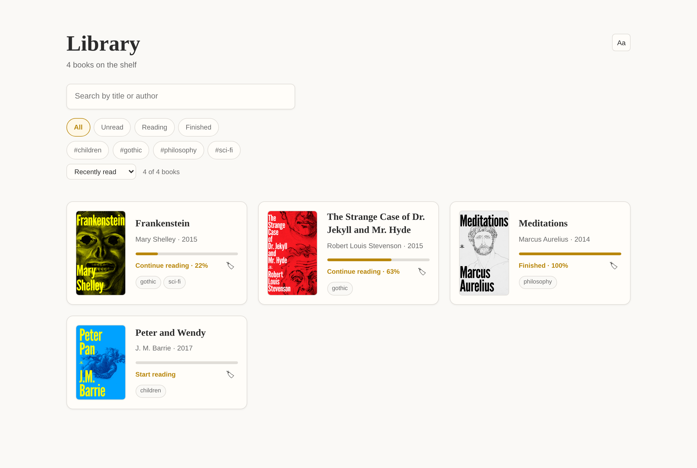
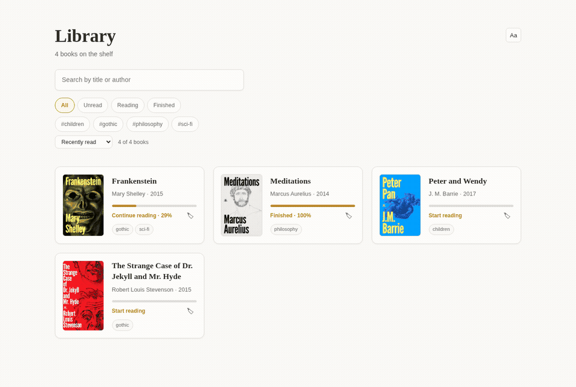
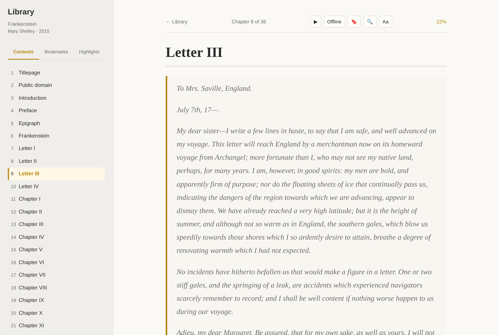
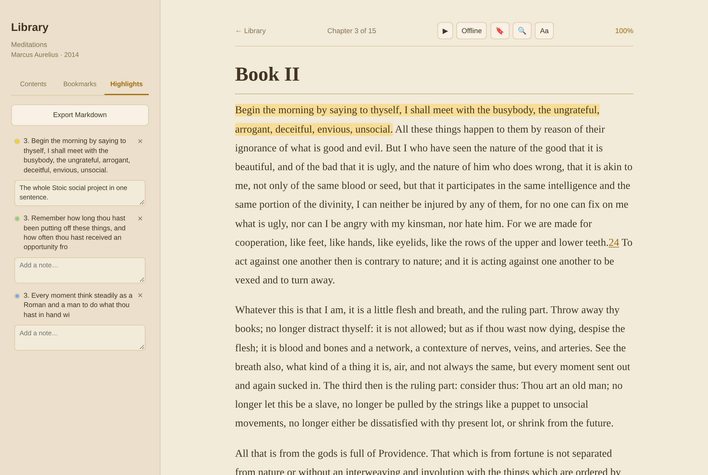
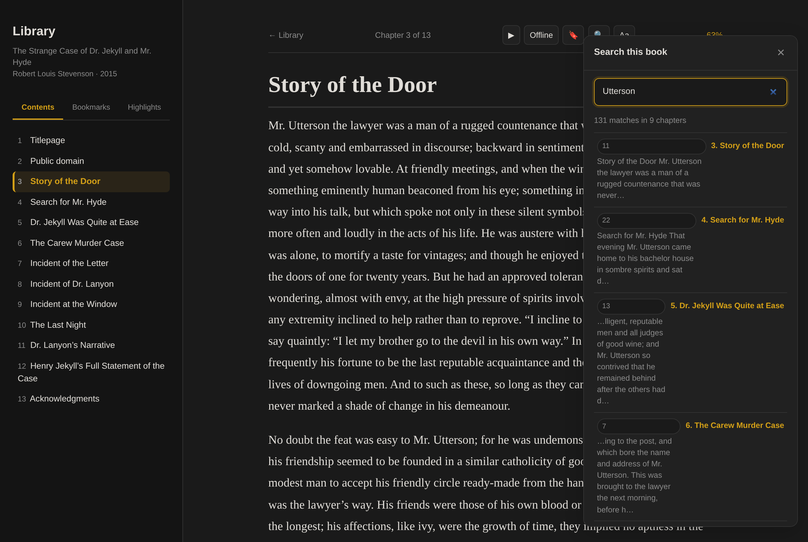
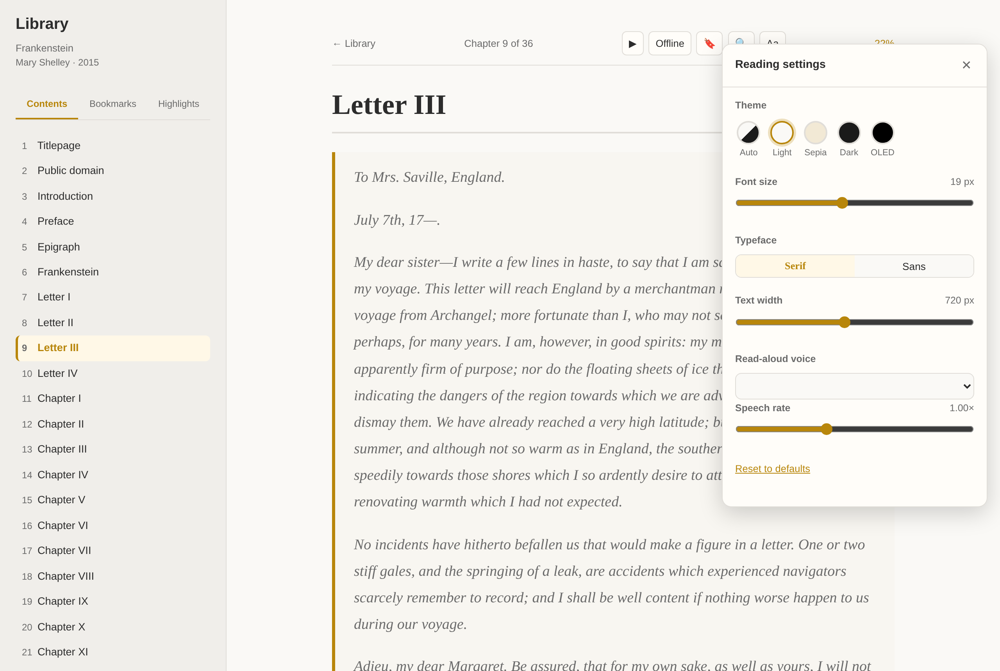
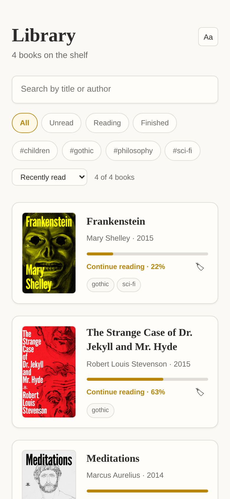
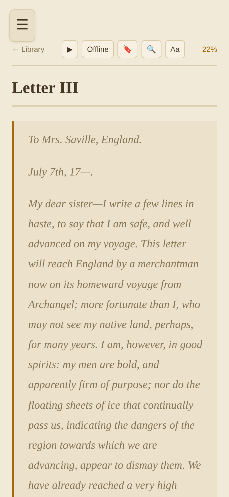

# markdown-book-reader

**Your books. Your server. Your phone. Your rules.**



A self-hosted reader that turns your DRM-free EPUB, PDF, and Markdown files into a clean, phone-friendly library on your own machine. It remembers the exact paragraph you stopped at, keeps highlights attached to the text they came from, and reads aloud in the browser. No cloud. No accounts. No telemetry.

[](LICENSE)
[](package.json)
[](requirements.txt)

## Six commands to your first book

Requirements: **Node.js 20+**, **Python 3.10+**, Linux or macOS.

```bash
git clone https://github.com/mubaid/markdown-book-reader.git
cd markdown-book-reader
npm install
npm run setup:python        # creates .venv with ebooklib, markdownify, PyMuPDF

# drop your .epub / .pdf / .md files into books/, then:
npm run convert
npm run serve
```

The server prints both addresses:

```
Library: http://localhost:9876
  phone: http://192.168.0.175:9876
```

Open the **phone** URL on any device on the same Wi-Fi and tap a book. That is the entire setup: no signup, no config file, no database. Your phone is now a reading device for a library that lives in your house.

- Port already taken? `PORT=9877 npm run serve`
- Prefer loopback-only? `HOST=127.0.0.1 npm run serve`

## A look around



*Eight seconds, no account: open a book where you stopped, highlight a sentence, find it in the sidebar.*

| The reader | Highlights, notes & bookmarks |
| --- | --- |
|  |  |
| **In-book search** (dark theme) | **Reading settings** |
|  |  |

On the phone, the same library — shelf and reader:

| Shelf | Reader |
| --- | --- |
|  |  |

*The demo and screenshots show public-domain editions from [Public Domain Library](https://publicdomainlibrary.org/en/), with demo reading progress. Nothing in them is mocked UI — this is the app running.*

## Why this exists

Most reading apps are rentals. You buy a book once, then pay forever for the shelf it sits on: an account, a sync service, an app that breaks when the company pivots. Your highlights live in a database you cannot open. Your place in the book is a scroll offset on someone else's server.

This project takes the other path. Your books stay ordinary files on a machine you own, and the reader is a website your server hands to any browser on your network. The best reading device you already carry — your phone — is one tab away from your own library, with nothing to install but a bookmark.

And if this project disappeared tomorrow, your library would still be readable in any text editor. That is the whole point.

## What makes it different

### Your place survives everything

Progress is anchored to a hash of the paragraph's text, not a scroll offset or a block number. Close the tab mid-sentence, come back next week, and the reader scrolls to that same paragraph. Reconvert the book with a better converter or fix a typo by hand: as long as the paragraph's text survives, so does your place. If a paragraph really did change, a saved scroll fraction catches you roughly nearby instead of dumping you at chapter one. A live percent in the reader tracks the whole book, not just the chapter. Details in [How resume works](#how-resume-works).

### Highlights that stick to the text

Select any passage and highlight it in yellow, green, or blue; add a note; bookmark the paragraph you are on. Everything is anchored to paragraph text hashes, so highlights survive reconversion the same way your reading position does. A highlight whose paragraph changed is kept and flagged when you next visit that chapter — not silently lost. When you are done, export the whole book's highlights and notes as one Markdown file with links that jump back to each passage.

### Search inside the book

Full-text search across every chapter, with snippets and per-chapter match counts. Tap a result and the reader jumps to the exact paragraph and marks every match on the page. Press `/` to open search from anywhere in the reader. Queries are matched literally and case-insensitively — no regex surprises, no index to rebuild.

### A shelf, not a file list

Covers, per-book progress bars, and "continue reading" cards sorted by what you read last. Tag books, filter by Unread / Reading / Finished or by tag, sort by recently read, title, author, or recently added. Search the shelf by title or author as you type. Author names are links: one tap opens a page with everything you own by that writer.

### Offline on your terms

Install the reader as a PWA over HTTPS or `localhost` (on iOS: Share → Add to Home Screen) and it keeps working when the network does not. Every chapter you open is cached, the next chapter is quietly cached ahead of you, and an **Offline** button in the reader pulls the whole book — images included — into the cache for airplane mode. The secure-context part is a browser rule, not a choice: on plain `http://` LAN addresses the app still installs and reads, but offline caching is unavailable. A reverse proxy with TLS (or a tunnel) in front of the server unlocks it. See [Limitations](#limitations).

### Read-aloud without an account

Tap ▶ and the browser reads from your current paragraph, following along across paragraphs and into the next chapter with auto-scroll. Voice and speed are yours to pick in settings. It uses the speech synthesis already built into your browser — no service, no key, no upload. It is screen-on read-aloud, and mobile browsers impose limits worth knowing: [Read-aloud limits](#read-aloud-limits).

### Plain files all the way down

Every book is a folder of Markdown chapters plus one JSON file. Fix a bad conversion in any editor and the change is live on the next page load — no rebuild, no restart, no export/import dance. The whole stack is one Node dependency (`marked`) and three Python converters. No database, no build step, no framework.

## Local-first, precisely

"Local-first" gets stretched to mean anything these days, so here is the exact deal:

**Stays on your server:** the books themselves — chapters, covers, images — as plain files in `library/`. They travel only to the browsers you serve them to.

**Stays in your browser:** reading progress, highlights, notes, bookmarks, tags, and settings, in `localStorage` on each device. Nothing is uploaded, because there is nowhere to upload to.

**Never exists:** accounts, analytics, telemetry, external APIs, API keys. The app makes no outbound requests at all — no update checks, no CDN, no web fonts, no phone-home. The only network traffic is your devices talking to your server.

Two caveats, stated plainly. State is per-browser: your phone and laptop each keep their own progress, and clearing browser data clears it — export highlights as Markdown to carry them elsewhere. And read-aloud uses your browser's speech engine; some browsers ship network-based voices, which is the browser's behavior, not the app's. Cross-device sync is a [roadmap](#roadmap) idea, not a shipped feature.

## Controls & specs

The exact ranges and behaviors, for when you want numbers instead of story:

| Area | What you get |
| --- | --- |
| Themes | Auto, Light, Sepia, Dark, OLED — applied before first paint, saved per browser |
| Typography | Serif or sans, 15–24 px font size, 520–960 px text width |
| Read-aloud | Voice picker, 0.7–1.5× rate |
| Shelf search | Title, author, transliterated titles, and tags, filtered as you type |
| Shelf sorts | Recently read, title, author, recently added |
| In-book search | Literal, case-insensitive, 2–100 characters, at most 50 chapter results |
| Highlight export | One Markdown file per book (`<book-id>-highlights.md`) with jump-back links |
| Storage keys | `markdown-book-reader:` + `progress:<id>`, `annotations:<id>`, `offline:<id>`, `tags`, `settings` |

## How it works

```
books/                ┌──────────────┐      library/<id>/           ┌───────────┐
  *.epub   ──────────▶│ convert_epub │──┐     book.json             │  Node HTTP │──▶ phone / laptop
  *.pdf    ──────────▶│ convert_pdf  │──┼──▶  NN-chapter.md  ──────▶│  + marked  │    browser reader
  *.md     ──────────▶│ convert_md   │──┘     cover.jpg, assets/    └───────────┘
                      └──────────────┘                                   │
                       Python, offline                          localStorage resume
```

All three converters emit the **same intermediate format** (`book.json` + chapter Markdown), so the server and reader are completely format-agnostic. The server reads those files per request and renders Markdown with `marked`; in-book search is a linear scan over the chapter files — no index, no cache, nothing to go stale. Reading state (progress, highlights, bookmarks, tags, settings) lives in the browser's `localStorage`, keyed per book.

```
assets/           reader CSS and JS (resume, annotations, search, TTS, settings)
tools/convert     CLI dispatcher (Node)
tools/*.py        EPUB / PDF / Markdown converters
tools/lib/        shared Python helpers
book.js           library loading + HTML templates
server.js         HTTP server
sw.js             service worker (offline caching)
```

## Adding books

Drop `.epub`, `.pdf`, and/or `.md` files anywhere under `books/` (subfolders are fine) and run `npm run convert`. Each book becomes:

```
library/<book-id>/
  book.json               # title, authors, chapter order
  00-chapter-title.md     # one Markdown file per chapter
  01-next-chapter.md
  cover.jpg               # catalog thumbnail
  assets/                 # images extracted from the book
```

Already-converted books are skipped; re-run with `--force` after a book updates. Your saved reading position survives reconversion because anchors are based on paragraph text, not block numbers.

Convert a single source:

```bash
npm run convert -- books/my-book.epub
npm run convert -- books/My-Novel.md
npm run convert -- books/my-novel/      # folder of .md chapters
```

| Flag | Effect |
| --- | --- |
| `--force` | Reconvert books that already exist in `library/` |
| `--no-images` | Skip EPUB image extraction and Markdown image copying |
| `--no-cover` | Skip cover extraction/rendering/detection |

### Markdown books

Two layouts, side by side with EPUB/PDF:

```text
books/My-Novel.md          # one file; split on its # or ## headings
books/My-Novel/            # one folder per book; each .md file is one chapter
  01-chapter-one.md
  02-chapter-two.md
```

- A folder with two or more direct `.md` files is **one book**, sorted naturally by filename (`2.md` before `10.md`).
- A loose `.md` file is **one book**, split on headings: one `#` plus two or more `##` uses the `#` as the book title and each `##` as a chapter; two or more `#` headings split on those. No usable headings → the whole file becomes a single chapter.
- Substantial preamble before the first chapter is kept as a "Front Matter" chapter.
- Relative `.md` links between chapter files are rewritten to the generated chapter IDs, so links keep working in the reader.
- Local images are copied into `assets/` with paths rewritten (`--no-images` keeps only the alt text).

Optional YAML front matter in the first file (or the single file):

```markdown
---
book_title: My Novel
author: Jane Doe
year: 2024
language: en
cover: cover.jpg
---
```

`title` is used per chapter in a folder book. For a single file, `book_title` (or `title`) overrides the heading-derived title. A byline like `Title - By Author` is split automatically when no front matter is present.

### Hand-editing

Everything in `library/` is plain files, so you can fix anything the converters get wrong:

- Edit chapter `.md` files — changes appear on the next page load, no rebuild or restart.
- Edit `book.json` to correct titles, authors, or chapter order.
- Keep chapter `id` values stable; saved resume positions refer to them.

Don't run `--force` on a book you've hand-edited unless you want the converter output to replace your edits. Without `--force`, existing books are left untouched.

## Reading

| URL | What you get |
| --- | --- |
| `/` | Shelf of books with covers and progress bars, most recently read first |
| `/author/<author-slug>` | Every book by one author (e.g. `/author/charlotte-bronte`) |
| `/<book-id>/` | Opens your saved chapter automatically |
| `/<book-id>/<chapter-id>` | A chapter with sidebar contents and prev/next |

### How resume works

The browser stores progress in `localStorage` under `markdown-book-reader:progress:<book-id>`:

```json
{
  "chapterId": "08-letter-iii",
  "chapterIndex": 8,
  "blockId": "blk-g3g8c7",
  "anchor": "g3g8c7",
  "chapterFraction": 0.42,
  "bookFraction": 0.23,
  "updatedAt": 1760000000000
}
```

The `anchor` is an FNV-1a hash of the paragraph's normalized text (Unicode-normalized, lowercased, punctuation stripped), so it identifies the paragraph by what it says rather than where it sits. On open, the chapter is restored first, then the paragraph whose hash matches `anchor`. If a reconversion changed that paragraph, the reader falls back to the saved scroll fraction. Each book has its own key.

Progress is per-browser and per-device — it does not sync between your phone and laptop (see [Roadmap](#roadmap)). Highlights, bookmarks, tags, and settings use the same per-browser storage.

## Limitations

- **EPUB DRM is not supported** — only DRM-free files you own.
- PDF extraction is text-first: equations and complex tables come out as plain text. Scanned PDFs need OCR before conversion.
- PDF images are not extracted (EPUB and Markdown images are).
- Two-column PDFs use a left-then-right reading-order heuristic; unusual layouts may need hand-editing.
- PDF chapter boundaries rely on the PDF's table of contents first, then font-size/heading detection.
- Markdown splitting needs consistent ATX headings (`#`, `##`) outside code fences.
- Markdown front matter is a simple `key: value` parser, not full YAML.
- Offline caching (service worker) only registers in a secure context: HTTPS or `localhost`. Browsers refuse service workers on plain `http://` LAN IPs, so phone offline reading needs a reverse proxy with TLS (or a tunnel) in front of the server.
- In-book search queries the server, so it needs a connection; offline, the search panel says so instead of pretending.

### Read-aloud limits

Read-aloud uses the browser's built-in speech synthesis. It works while the screen is on; mobile browsers may suspend speech when the screen locks or the tab goes to the background (iOS Safari is the strictest). Voice quality depends on the voices your browser provides — Android Chrome and iOS Safari ship different sets. If your browser has no speech synthesis, the read-aloud buttons don't appear at all.

## Troubleshooting

**`No module named ebooklib` / `markdownify`** — run `npm run setup:python`, or check that `.venv/bin/python` exists.

**`Port 9876 is already in use`** — `PORT=9877 npm run serve`.

**A chapter 404s after renaming files** — re-run `npm run convert -- --force` or restore the file name recorded in `book.json`.

**Resume lands at the top** — the paragraph changed after reconversion, or `localStorage` was cleared. The scroll-fraction fallback is intentionally rough.

**Phone can't reach the server** — both devices must be on the same Wi-Fi; check your firewall allows inbound TCP on the port. Some routers isolate Wi-Fi clients ("AP isolation") — disable it or use a hotspot.

**Highlights or progress missing on another device** — expected: state is per-browser `localStorage`, not synced. Export highlights as Markdown to carry them elsewhere.

## Roadmap

Ideas, not promises — PRs welcome:

- [ ] PDF image extraction
- [ ] Optional OCR pass for scanned PDFs
- [ ] Cross-device progress sync (still local-first)
- [ ] Full YAML front matter support

## Contributing

This is a small codebase on purpose: one Node dependency, three Python converters, no build step. Edit a file, reload the page, see the change — that loop is the entire development environment, and it is a friendly place to start.

Fork the repo, create a branch, and open a pull request. The [roadmap](#roadmap) lists where the project wants to go; [open an issue](https://github.com/mubaid/markdown-book-reader/issues) to report a bug or discuss an approach before building it.

Four rules keep the project what it is:

1. Keep it local-first: no cloud services, no accounts, no telemetry.
2. Keep the footprint small: new dependencies need a strong justification.
3. The converters must keep emitting the same `book.json` + Markdown format — the reader stays format-agnostic.
4. Test with a real book (EPUB *and* PDF if you touch conversion), and don't commit copyrighted book files — `books/` and `library/` are gitignored for exactly that reason.

## License

[MIT](LICENSE) © 2026 Mohamed Ubaid. Use it, fork it, ship it — just keep the copyright notice.

**Note:** this tool is for books you legally own. It does not strip DRM and ships with no book content.